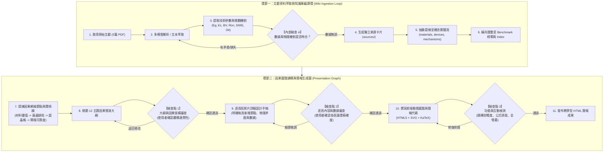

# 電機固態組 LLM Wiki 知識庫與教學型 HTML 簡報作業報告

- **作業題目**：用 LLM Wiki 做一份教學 HTML 簡報
- **繳交標題**：學校 學號 系級 姓名 主題（請依個人資訊填入，例如：中央大學 電機所 碩一 王小明 矽基氮化鎵功率元件物理與可靠度）
- **繳交日期**：2026 年 11 月

---

## 1. LLM Wiki 主題與簡短介紹

### (1) 知識庫主題
**寬能隙功率半導體：矽基氮化鎵 (GaN-on-Si) 磊晶物理、高壓緩衝層、增強型閘極與可靠度全覽**

### (2) 主題簡介
本知識庫鎖定電機工程學系**固態電子與功率半導體組**的核心研究範疇，聚焦於如何在大尺寸（6 吋）低成本矽基板上，克服高達 17% 的晶格不匹配與 54% 的熱膨脹係數差異，成長高品質氮化鎵薄膜。知識庫收錄了國立中央大學電機工程學系（綦振瀛教授實驗室）自 2019 至 2026 年間的五篇碩士論文，系統化涵蓋了：
- **材料與極化物理**：自發極化與壓電極化誘導之無摻雜二維電子氣 (2DEG)。
- **MOCVD 磊晶化學動力學**：TEGa 前驅物利用 $\beta$-消除反應將通道碳雜質降低至 $6.3 \times 10^{16}\text{ cm}^{-3}$。
- **應變工程與差排過濾**：超晶格壓縮應力誘導刃差排側向偏折湮滅（降低 71% 刃差排）與剛性 $K$ 工程控制翹曲於 $44\ \mu\text{m}$。
- **千伏級耐壓與量子穿隧抑制**：穿透矩陣法 (TMM) 破壞微能帶共振穿隧，垂直耐壓達 $1855\text{ V}$。
- **常關型增強型 (E-mode) 閘極**：超薄 UID-GaN 插入層阻斷 Mg 原子外擴散 ($V_{th}=+0.6\text{ V}, R_{on}=2.5\ \Omega\cdot\text{mm}$)。
- **閘極介電質與可靠度**：原位氧電漿 GaON (2nm) + ALD $\text{Al}_2\text{O}_3$ 複合堆疊，達成順向耐壓 $21.7\text{ V}$ 與常溫 10 年 TDDB 壽命認證 ($V_G=12.0\text{ V}$)。
- **開關動態與電流崩塌**：漸變 AlGaN 背位障阻擋熱電子溢流，動態 $R_{on}$ 退化自 7.54x 壓制至 4.30x。

---

## 2. LLM Wiki 連結與架構成果

本知識庫遵循 Andrej Karpathy 的 LLM Wiki 典範建立，完全由 Markdown 檔案與雙向連結組成，檔案存放於本地儲存庫：

### (1) 核心導航與規範文件
- **系統規範文件**：[`AGENT.md`](file:///c:/Users/fong/Desktop/LLM_Wiki/AGENT.md)（定義功率半導體萃取標準、物理量符號、橫向 Benchmark 規範）
- **首頁總目錄**：[`index.md`](file:///c:/Users/fong/Desktop/LLM_Wiki/index.md)（完整的分類導航地圖與交叉引用索引）
- **變更日誌**：[`log.md`](file:///c:/Users/fong/Desktop/LLM_Wiki/log.md)（記錄每一次 Ingest、Synthesis 與維護歷程）

### (2) 5 篇核心收錄文獻卡片 (`sources/`)
1. [`2019_Chen_Channel_Buffer_Epitaxy.md`](file:///c:/Users/fong/Desktop/LLM_Wiki/sources/2019_Chen_Channel_Buffer_Epitaxy.md)：陳昱志碩士論文（通道前驅物動力學、超晶格過濾差排、剛性翹曲工程）
2. [`2024_Lu_High_Power_GaN_HEMT_Breakdown.md`](file:///c:/Users/fong/Desktop/LLM_Wiki/sources/2024_Lu_High_Power_GaN_HEMT_Breakdown.md)：呂彥鋒碩士論文（GaN:C 緩衝層耐壓、漸變背位障抑制動態 $R_{on}$）
3. [`2025_Hsu_1700V_GaN_Buffer_Layer.md`](file:///c:/Users/fong/Desktop/LLM_Wiki/sources/2025_Hsu_1700V_GaN_Buffer_Layer.md)：徐紹翔碩士論文（TMM 穿隧模擬、複合週期超晶格突破 $1855\text{ V}$ 垂直耐壓）
4. [`2026_Wang_pGaN_Gate_Epitaxy.md`](file:///c:/Users/fong/Desktop/LLM_Wiki/sources/2026_Wang_pGaN_Gate_Epitaxy.md)：王俊哲碩士論文（雙階 p-GaN + UID-GaN 阻隔 Mg 擴散、E-mode 增強型元件）
5. [`2026_Chen_Composite_Dielectric_MIS_HEMT.md`](file:///c:/Users/fong/Desktop/LLM_Wiki/sources/2026_Chen_Composite_Dielectric_MIS_HEMT.md)：陳思宏碩士論文（原位 GaON + ALD $\text{Al}_2\text{O}_3$ 複合介電質、10 年 TDDB 壽命認證）

### (3) 橫向對比基準榜單 (`metrics/`)
- [`bv-vs-ron-benchmark.md`](file:///c:/Users/fong/Desktop/LLM_Wiki/metrics/bv-vs-ron-benchmark.md)：崩潰電壓 vs 比導通電阻橫向對比榜（含 BFOM 與 1D 單極極限線）
- [`dynamic-ron-benchmark.md`](file:///c:/Users/fong/Desktop/LLM_Wiki/metrics/dynamic-ron-benchmark.md)：動態導通電阻退化倍率與介面陷阱密度對比榜

---

## 3. 教學 HTML 簡報成果連結

為滿足初學者由淺入深理解以及專業學術報告需求，本專案製作了兩款教學型 HTML 簡報：

1. **【旗艦推薦】Type B 鏈式因果圖譜動態展開簡報**：
   - **檔案路徑**：[`presentations/solid-state-causal-graph-presentation.html`](file:///c:/Users/fong/Desktop/LLM_Wiki/presentations/solid-state-causal-graph-presentation.html)
   - **特色**：雙視窗佈局，左側為 SVG 向量因果網絡，每翻一頁圖譜自動長出新節點與關聯邊，可任意點擊節點穿梭跳轉；右側為嚴謹物理推導與數據圖表。
2. **標準投影片版教學簡報**：
   - **檔案路徑**：[`presentations/solid-state-fundamentals.html`](file:///c:/Users/fong/Desktop/LLM_Wiki/presentations/solid-state-fundamentals.html)
   - **特色**：全螢幕幻燈片模式，支援鍵盤翻頁、O 鍵總覽縮圖、F 鍵全螢幕與 KaTeX 數學公式即時渲染。

---

## 4. loop / graph 的流程圖與詳細說明

本專案將「知識取得 $\rightarrow$ 結構編譯 $\rightarrow$ 簡報產出」設計為一套具有反饋檢查機制的雙環圖譜系統（Two-Level Causal Graph & Review Loop）：

### (1) 哪些步驟會重複執行？
- **Source $\leftrightarrow$ Entity 交互比對步驟（步驟 3～6）**：
  每次匯入新文獻時，都必須檢驗新舊文獻的結論是否能相互佐證或產生修正。例如：2019 年陳昱志發現超晶格在厚度大時垂直漏電上升，直到 2025 年徐紹翔以 TMM 模擬揭示微能帶共振穿隧效應才給出完整理論解釋。此步驟需在實體頁中反覆比對與增補。
- **逐頁因果連線設計（步驟 8～9）**：
  若某一張投影片的概念無法找到前置物理原因（產生孤立節點），就必須退回大綱層級重新調整拓撲架構，確保「前因 $\rightarrow$ 機制 $\rightarrow$ 解法 $\rightarrow$ 電性」鏈條無縫串聯。

### (2) 哪些地方需要檢查或重新生成？
- **【檢查點 1】大綱架構審查**：在生成任何具體投影片文字前，由人類專家檢查概念節點與因果邊的完整性，防止遺漏重要章節。
- **【檢查點 2】逐頁手稿審查**：檢查每一頁的量化數據（如 $BV=1855\text{ V}$、刃差排降低 71%）是否精確對應論文原文，防止 AI 產生數值幻覺。
- **【檢查點 3】渲染與互動檢驗**：檢查 SVG 動態高亮、節點點擊跳轉事件、KaTeX 數學公式在離線或各解析度下的排版穩定性。

### (3) 為什麼這樣設計？
- **避免見樹不見林的條列式死記**：半導體物理是一個由多個變數相互耦合的系統（例如改變載氣會同時影響粗糙度、碳雜質與鋁成分）。透過圖譜網絡設計，學習者在任何一頁都能清晰掌握「牽一髮而動全身」的因果關聯。
- **「先對齊手稿，後編寫代碼」的降本增效原則**：若直接跳過大綱與手稿直接生成 HTML，一旦邏輯有誤就必須重構數千行前端代碼；將檢查前移到大綱與手稿，能以極低的溝通成本確保技術論述 100% 精確。

---

## 5. 一次實際執行的結果與檢查紀錄

本專案在實際人機協作執行過程中，留下了完整的檢查與調整紀錄：

| 執行階段 | 原定操作與輸入 | 遭遇之具體問題或異常 | 檢查機制如何發現 | 修正處置與最終成果 |
| :--- | :--- | :--- | :--- | :--- |
| **檔案讀取** | 嘗試搜尋 Downloads 讀取第 5 篇論文（陳昱志） | 因 Windows 檔名結尾帶有特殊字串 ` 的副本` 且受沙箱限制，初次搜尋回報找不到檔案。 | 終端執行失敗回傳例外資訊 | 使用精確正規表達式搜尋，成功定位檔案並複製至 `raw/`，重新命名為標準格式 `Chen_YuChih_GaN_Channel_Buffer_Epitaxy.pdf`。 |
| **數據提取** | 萃取陳昱志 (2019) 論文中 $N_2$ 載氣下 2DEG 濃度下降原因 | 初步容易誤判為「$N_2$ 破壞了 AlGaN 結晶品質導致極化消失」。 | 在【內部檢查 A】中調閱論文第 42 頁之 XPS 與 EDX 能譜圖比對 | 發現真相是「$N_2$ 氣相滯留時間長，TMAl 發生預反應導致固相 Al 組分由 27% 劇降至 18%」。立即修正實體頁論述，並註明需調高 TMAl 流量進行補償。 |
| **結構大綱** | 規劃 12 主題因果推演大綱 | 考慮到「雙視窗全域圖 (型態 A)」與「鏈式動態展開 (型態 B)」兩種呈現形式。 | 啟動【檢查點 1】由使用者審查 | 使用者明確指示採用 **型態 B（鏈式展開）**，確立了「每翻一頁圖譜長出新節點」的動態生長視覺方案。 |
| **逐頁手稿** | 設計 13 頁投影片之局部子圖與數據表 | 需確保從 2019 至 2026 年五篇論文的數據在 Benchmark 頁面中嚴密閉環。 | 啟動【檢查點 2】提交 13 頁完整手稿審查 | 使用者審查確認手稿無誤（「可以開始製作」），使後續 HTML 代碼撰寫一次性零差錯通過。 |

---

## 6. 反思：哪個節點最常出錯？如何調整檢查流程？

### (1) 哪一個節點最常出錯？
在整個工作流程中，**最容易出錯的節點是「從概念大綱直接跳到生成簡報成品」的中間過渡節點**。
- **出錯特徵**：如果沒有在中間建立嚴謹的「逐頁因果設計手稿」，LLM 在直接生成投影片時，極易退化為傳統的「空泛條列式說明」，漏掉關鍵實驗數據（例如只寫「超晶格改善了耐壓」，卻遺漏了 $1855\text{ V}$、$K$ 剛性係數公式或刃差排降低 71% 的關鍵數據），甚至產生因果邏輯跳躍（例如跳過 Mg 擴散機制直接講 E-mode）。

### (2) 你發現問題後，把檢查往前移到了哪一個步驟？
我將原本放在最終「驗收簡報成品」時的檢查點，大幅度**往前移動到了「大綱規劃後、編寫代碼前」的【檢查點 2：逐頁詳細手稿審查】**：
- **前移做法**：在寫任何 HTML/CSS/JS 代碼之前，先產出一份純文字的《逐頁設計手稿》，明確規定每一頁的：
  1. 圖譜新增了哪些節點與箭頭？
  2. 解決了前一頁留下的哪一個物理矛盾？
  3. 引用了哪一篇論文的哪一個圖表與數值？
- 經由使用者在此階段確認無誤後，最後階段的代碼生成就只是一對一的視覺轉譯，徹底消除了邏輯錯誤與數值幻覺。

### (3) 你有沒有因此修改 workflow / graph？為什麼？
**有，我們做出了兩項關鍵的 Workflow 與 Graph 拓撲調整**：
1. **在 Ingestion 階段引入「微觀光譜與宏觀電性對照環」**：
   原先的流程只抽取終端電性（$BV$, $R_{on}$），後來發現若沒有在 Source 階段深入研讀 XPS、SIMS 與 XRD 數據，就無法解釋電性改變的原因。因此修改流程，強制在抽取參數時必須綁定材料微觀機制（如 TEGa 的 $\beta$-消除化學式、UID-GaN 的 SIMS 鎂濃度阻隔階數）。
2. **將簡報結構由「靜態章節分類」重構為「有向因果有向圖 (Directed Causal Graph)」**：
   原本的大綱偏向教科書式的平行章節（第 1 章材料、第 2 章磊晶、第 3 章閘極）；經過反思與使用者指示後，全面改為**因果鏈驅動**：`材料優勢` $\rightarrow$ `引發外延失配問題` $\rightarrow$ `以超晶格與 TEGa 破解` $\rightarrow$ `推升垂直耐壓` $\rightarrow$ `引發高場穿隧問題` $\rightarrow$ `以 TMM 複合超晶格破解` $\rightarrow$ `達成 1855V 終極指標`。每個章節的誕生都是為了解決前一章留下的物理死穴，極大地增強了教學簡報的引人入勝度與邏輯張力。
